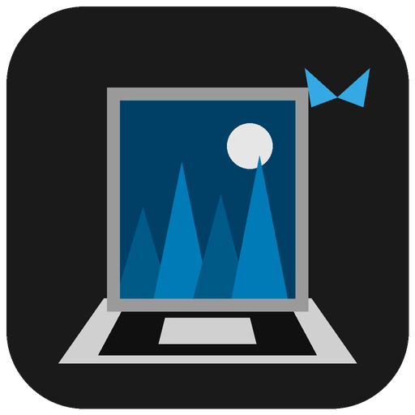
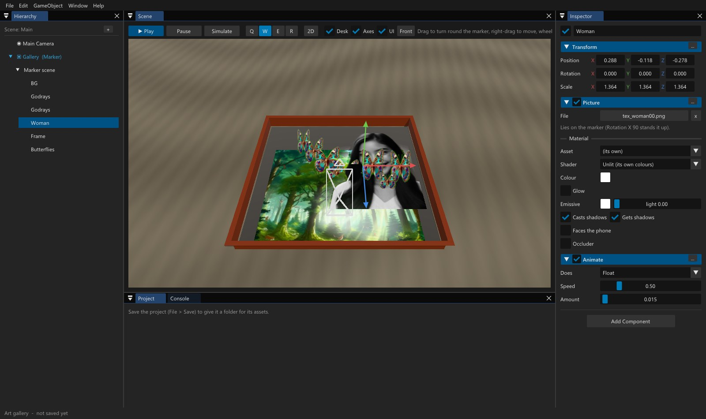

[](https://x.com/NorowaretaGemu)
[](LICENSE)

<br>
<div align="center">
  <a href="https://ko-fi.com/cursedentertainment">
    
  </a>
</div>
<br>

<div align="center">
  
  
</div>
<br>

<div align="center">
  
</div>

# Diorama

**Little worlds on markers.** Diorama is Atelier's augmented reality engine: build scenes on printed markers the way
you would in Unity, then build them into a game that runs in any phone's browser. No Unity, no app store, no webcam
needed to make the markers. Part of [Atelier](https://github.com/CursedPrograms/Atelier).

**Website:** https://cursedprograms.github.io/Diorama/



## What it does

- **Laid out like Unity:** a Hierarchy (AR markers at the top, objects under them; drag to parent), the Scene view,
  an Inspector. Every object is an empty with a **Transform**; its look, **Animate** and **Scripts** are components,
  each with its on/off tick, Reset and Remove, and **Add Component**.
- **Unity's tools:** click to pick, **Q W E R** hand / move / rotate / scale handles (Ctrl snaps), **F** to frame,
  Ctrl+D, Delete, Ctrl+Z / Ctrl+Y; Transform values drag up/down or sideways and the view follows live.
- **Objects:** empties, planes, cubes, spheres, capsules, cylinders, quads; pictures (see-through PNGs); **glTF / GLB
  models with their bones and animation clips**; flocks of sprites (butterflies, leaves, sparks); light rays; words.
- **Markers without a webcam:** Hiro, Kanji, or a pattern made from any picture or letter (the `.patt` is written
  from the picture), and 3x3 barcodes 0..63; each printable, and a sheet of them all.
- **A window into the marker:** scenes can go down into the paper and only show through an opening, like a
  shadow-box gallery.
- **Each marker's light:** ambient colour, sun colour, strength and direction.
- **Build:** File > Build Game makes a **static website** (jsartoolkit5 + three.js): put the folder on any https host
  (GitHub Pages, Netlify, itch.io) and open it on a phone. **▶ Play** (Ctrl+P) builds it and opens it in your browser
  with the webcam, like Unity's Play mode.
- **The art gallery template:** the ARToolkit art gallery (a Unity demo) remade: a frame on the Kanji marker, a forest
  inside it, a person, god rays and butterflies flying out.

Coming: JavaScript scripting with a built-in editor, Build Settings (name, icon, splash and intro), Android builds,
Unity-like materials and shaders, FBX import.

## Install

Download `Diorama-win64.zip` from the [releases](https://github.com/CursedPrograms/Diorama/releases), unzip it and
run `install.bat`, or install it from the Atelier launcher.

## Build

Needs Visual Studio 2022 (C++) and CMake; SDL2 and Dear ImGui are fetched once.

```bat
build.bat      :: build\Release, dist\Diorama and dist\Diorama-win64.zip
install.bat    :: installs dist\Diorama for this user
```

On Linux: `./build.sh` (cmake, a C++17 compiler, libsdl2-dev) and `./install.sh`.

## Credits

Games are built on [jsartoolkit5](https://github.com/artoolkitx/jsartoolkit5) (LGPL-3.0) and
[three.js](https://threejs.org) (MIT), shipped in every build with their licences. Diorama itself uses
[Dear ImGui](https://github.com/ocornut/imgui), [SDL2](https://www.libsdl.org), [cgltf](https://github.com/jkuhlmann/cgltf)
and [stb](https://github.com/nothings/stb). The art gallery template's pictures and frame are from
[ARToolkit-ArtGallery-Template](https://github.com/CursedPrograms/ARToolkit-ArtGallery-Template). See [NOTICE](NOTICE).

<br>
<div align="center">
<a href="https://cursedprograms.github.io/Diorama/" target="_blank">
    
</a>
</div>

---
<br>
<div align="center">
<a href="https://github.com/Farica-Kimora">Farica☆Kimora</a> © Cursed Entertainment 2026
</div>
<br>
<div align="center">
<a href="https://cursed-entertainment.itch.io/" target="_blank">
    
</a>
</div>
